

  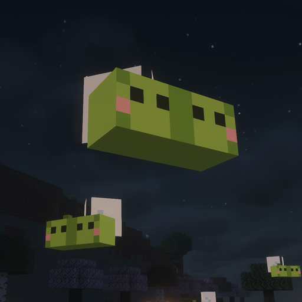

# Fertile Grounds

 

I originally started this little farming mod for my partner and me to play on our private server. It began as a few richer soils that save you from bone-mealing the same field over and over, and it grew from there: a shy Bean Fairy who visits at night, hotels for fairies who decide to stay, and, late in the game, whole gardens the fairies build for you.

**Richer soil, shy edamame fairies, and a farm that grows a little faster every day.** Fertile Grounds is a cozy Fabric mod that keeps the vanilla look and plays nicely with big farming mods. Get it on [Modrinth](https://modrinth.com/mod/fertile-grounds) or [CurseForge](https://www.curseforge.com/minecraft/mc-mods/fertile-grounds).

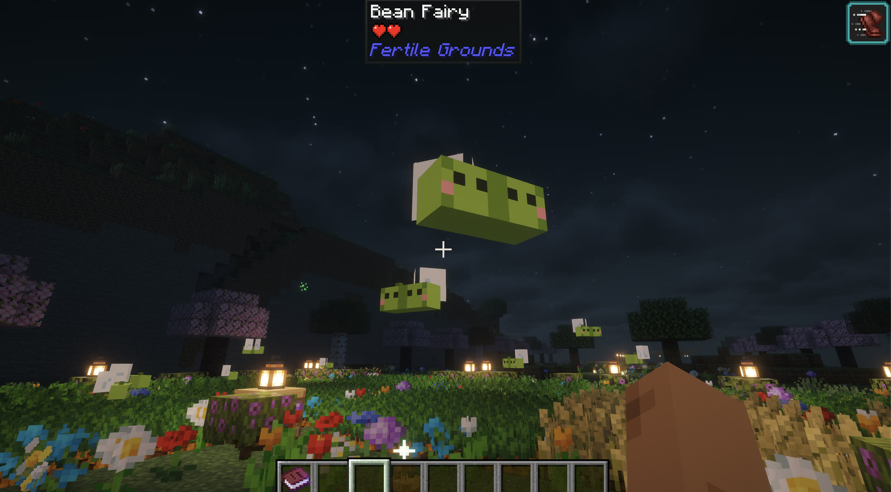

## Your guide book

Every player gets a **Fertile Grounds Guide** the first time they join a world with the mod. It explains every feature in a few short pages, in your own language. Lost it? Craft a new one from a **Book** and **Bone Meal**. You can also [read the guide here on GitHub](docs/GUIDE.md), along with every setting you can change.

## Grow more, work less

<table align="center">
  <tr>
    <td align="center">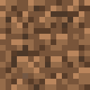 <b>Enriched Dirt</b> Dirt + Bone Meal</td>
    <td align="center">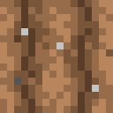 <b>Enriched Farmland</b> till it with a hoe</td>
    <td align="center">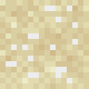 <b>Enriched Sand</b> Sand + Bone Meal</td>
  </tr>
  <tr>
    <td align="center">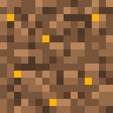 <b>Super Enriched Dirt</b> add Glowstone Dust</td>
    <td align="center">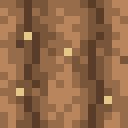 <b>Super Enriched Farmland</b> the fastest soil</td>
    <td align="center"> <b>Fertilizer</b> upgrades soil in place</td>
  </tr>
</table>

- **Enriched Soil** gives your crops a free pinch of bone meal now and then, so they grow about 4 times faster, or 11 times faster on **Super Enriched** soil.
- **Fertilizer** upgrades the farm you already have, right under your crops. No digging up, no replanting.

## Meet the Bean Fairy

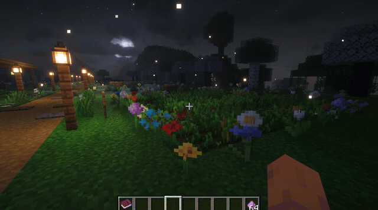

- Some nights, a tiny Bean Fairy floats down and grows a whole patch of crops at once. **Fairy Dust** calls one on purpose.
- Flowers and beehives make your farm more welcoming, and under a full **Harvest Moon** fairies visit three times as often.
- Fairies sometimes leave a gift behind. Bigger farms get better gifts.

## Catch a fairy

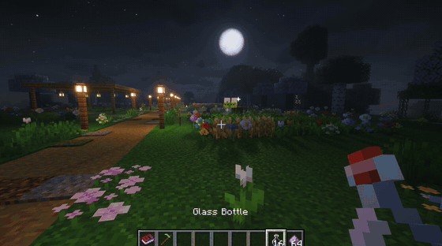

After its work, a fairy stays for a minute. Sneak up slowly, since running scares it off, and use a **Glass Bottle** on it. A jarred fairy slips away after 3 days, so give it a home before then.

## Give it a home

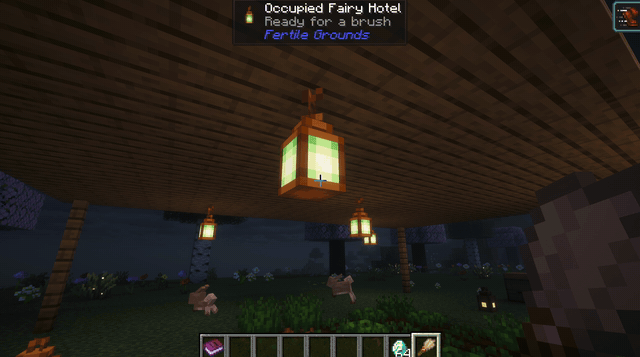

- Build a **Fairy Hotel** and your fairy moves in for good. Hotels stand or hang like lanterns.
- A hotel fairy helps nearby crops grow, fills beehives with honey, keeps creepers away, and stops trampling. You even walk a little faster near it.
- Brush the hotel once a day. Fairies love it, and they help a little more after.

## Hear when it's harvest time

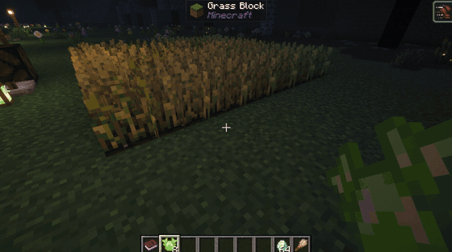

Upgrade a hotel to a **Chime Hotel** with a Note Block and a Spyglass. Its fairy watches the field and rings a soft chime when the crops are ready. Put a comparator behind it, and the chime sends a redstone signal to a lamp or a farm machine.

## Grow a Fairy Grove

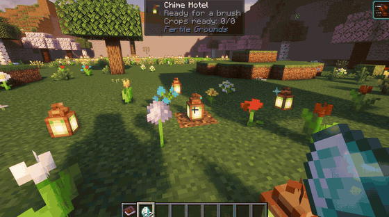

A cozy farm is fun. Breaking 400 dirt blocks to build one the first time is not. So late in the game, build a shrine: a Chime Hotel on Super Enriched Dirt, with hotel fairies around it and flowers nearby. Give it a **Diamond**, and its fairies turn the land around it into a leveled, lantern-lit garden of watered farm plots, hedges, and beehives. If anything built by a player is in the way, the shrine tells you and keeps your diamond.

## Little extras

- Optional **[Jade](https://modrinth.com/mod/jade)** tooltips show soil boosts, coming visits, and how many crops are ready.
- Wandering Traders sometimes sell Fairy Dust and Fertilizer.
- Its own advancement tab, with seven advancements to earn.

## Built to fit in

Fertile Grounds is made to drop into a modpack without fuss. It hasn't been tried in every pack, but this is how it stays out of the way:

- **It builds on vanilla.** The new farmland is vanilla farmland underneath, so crops, hoes, and other mods' farming tools treat it like the real thing. No world generation changes, and no new biomes or ores.
- **Tags instead of hard-coded lists.** Fairies grow anything in the crops tag and count flowers from the shared `c:flowers/small` tag, so crops and flowers from other mods join in with no extra code.
- **Light touch on Minecraft's code.** It uses Fabric API's hooks wherever it can, with only four small mixins, each for a spot Fabric API doesn't cover. Fewer mixins means fewer clashes with other mods.
- **Optional extras stay optional.** Jade support loads only when Jade is installed, and the tests run with and without it.
- **Settings live in the world.** Every number is a gamerule, so a server sets them once and every player sees the same rules, and datapacks can replace the trades, gift loot, and tags.
- **Tested in the game.** About 100 automated in-world tests run on every build for each Minecraft version, along with a check that the game loads every model and texture with no warnings.

## Versions

Fertile Grounds 2.0 runs on Minecraft **26.1, 26.2, and 26.3** with [Fabric API](https://modrinth.com/mod/fabric-api). On Minecraft 1.21.11 or older, use version 1.2.0, which has the enriched soils and Bean Fairy visits. Only 26.1 and newer get new features from now on.

## For modpack makers

Every number is a gamerule, and crops and flowers come from tags, so modded content works without code. The [guide](docs/GUIDE.md#settings-and-commands) lists every setting with a ready-to-paste command, and [docs/DETAILS.md](docs/DETAILS.md) has the exact numbers, recipes, and tags.

## Contributing

Bug reports, ideas, translations, and code are all welcome. [CONTRIBUTING.md](CONTRIBUTING.md) explains how to set up the project, how features are planned, and how the tests work. Found a security problem? See [SECURITY.md](SECURITY.md).

## Art

The art in this repo is partially AI generated. I'm using AI to help me learn pixel art: it draws guides for me, and I trace over them by hand. I also ask it for help learning Aseprite, color theory, and how Minecraft models work. If you know other ways to learn that would let me keep building Minecraft mods at the same pace, I'm open to suggestions!

I trace over vanilla textures so I don't borrow stylistic choices from other artists.

## Feedback and license

Found a bug or have an idea? [Open an issue](https://github.com/Adi-UA/fertile-grounds/issues/new/choose), or share your farm in [Discussions](https://github.com/Adi-UA/fertile-grounds/discussions). MIT licensed, see [LICENSE](LICENSE).
