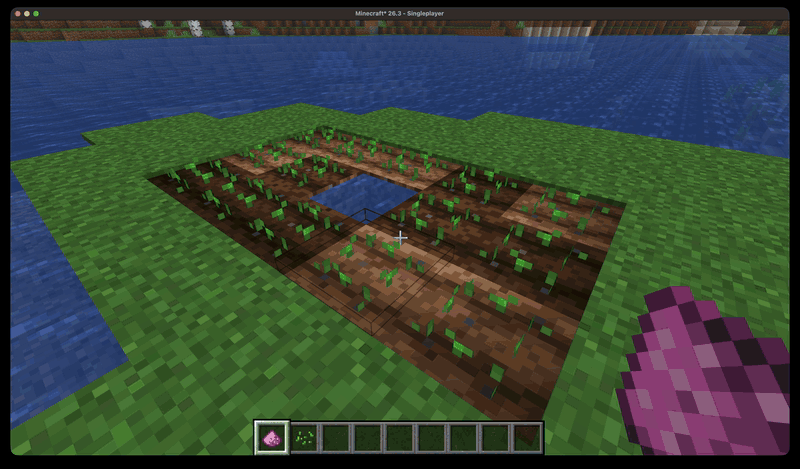

<p align="center">
  
</p>

# Fertile Grounds

[](https://github.com/Adi-UA/fertile-grounds/actions/workflows/build.yml)

[](https://modrinth.com/mod/fertile-grounds) [](https://www.curseforge.com/minecraft/mc-mods/fertile-grounds)

Available on [CurseForge](https://www.curseforge.com/minecraft/mc-mods/fertile-grounds) and [Modrinth](https://modrinth.com/mod/fertile-grounds).

Fertile Grounds is a Fabric mod for Minecraft 26.3 that adds tiered soil-enrichment blocks. Place one once, and it has a chance every so often to bone-meal whatever grows on top of it on its own, so you stop manually reapplying bone meal to the same farm every few minutes. That works out to roughly 4x faster growth on Tier 1/Tier 2 soil and roughly 11x faster on Super Enriched soil, for a single well-watered crop. It's a convenience upgrade, not a balance-breaking one: the soil still floods, dries out, and gets trampled like normal dirt or sand.


*Recorded with `/gamerule randomTickSpeed 100` to make the difference visible in a short clip. Default random tick speed (3) looks the same relative to each other, just much slower in real time.*



**New in version 1.2.0: Bean Fairies.** Like Stardew Valley's Crop Fairy, one can show up on any night and fully grow a patch of your crops. Or craft Fairy Dust and sprinkle it on a crop to guarantee a visit that night.

## What it adds

Three tiers, each a drop-in soil upgrade that behaves like its vanilla counterpart (till it, plant on it, it still floods/dries/tramples) but with a chance per random tick to instantly advance whatever's growing on top of it, as if bone-mealed:

| Tier | Block(s) | Crafted from | Boost chance/tick |
|---|---|---|---|
| 1 | Enriched Dirt / Enriched Farmland | Dirt + Bone Meal | 15% |
| 2 | Enriched Sand | Sand + Bone Meal | 15% |
| 3 | Super Enriched Dirt / Super Enriched Farmland | Dirt + Bone Meal + Glowstone Dust | 50% |

All three are craftable (shapeless, 1:1:1, no crafting table shape required) and unlock in the recipe book the first time you hold the right ingredients.

**Enriched Dirt / Super Enriched Dirt** work exactly like vanilla dirt: till them into farmland with a hoe, only the farmland form accepts crops. Their farmland reverts back to their *own* dirt tier (not vanilla dirt) on drought or trampling, and shows a darker, moist texture at full hydration, same as vanilla farmland.

**Enriched Sand** behaves like vanilla sand (sugar cane can still be planted on it near water), no tilling involved. It boosts whatever bonemealable plant is directly on top of it, bamboo is the clearest example since it can grow on sand; sugar cane and cactus don't accept bone meal in vanilla, so they grow at normal speed on it either way.

**Fertilizer** upgrades soil you already farm on, so you don't have to dig up a farm and replant it. Use it on vanilla or Enriched dirt or farmland to turn it into the Super Enriched version, or on vanilla sand to turn it into Enriched Sand. The crop on top keeps its growth stage and farmland keeps its moisture. Dispensers apply it to the block they face. Craft 4 (shapeless) from 1 Bone Meal, 2 Glowstone Dust, and 6 small flowers in any mix; the recipe unlocks when you pick up Glowstone Dust.

All of the mod's items live in their own creative-inventory tab, "Fertile Grounds."

### Bean Fairy

Like Stardew Valley's Crop Fairy, a Bean Fairy (a tiny winged edamame pod) sometimes visits a farm at night and fully grows every crop in a 5x5 patch. Each night, every player in the Overworld has a 1% chance of a visit to a random crop within 16 blocks. If everyone sleeps through it, the crops are grown at dawn anyway.

A welcoming farm raises the odds. Each different kind of small flower within 8 blocks of the crop adds a tenth of the base chance (up to 10 kinds), and a beehive or bee nest nearby adds half. On full-moon nights a **Harvest Moon** rises: everyone in the Overworld gets a message, and the chance triples, so a farm with 10 kinds of flowers and a hive gets 7.5% instead of 1%.

To call one on purpose, craft **Fairy Dust** (shapeless: Glowstone Dust + Amethyst Shard + Bone Meal) and use it on a growing crop. Fairies still only come at night: within about 30 seconds if it's already dark, otherwise at nightfall. Only crops in the `fertilegrounds:fairy_crops` tag count, which by default is vanilla's `#minecraft:crops` (wheat, carrots, potatoes, beetroots, melon and pumpkin stems, torchflowers, pitcher plants) plus any modded crop that joins it.

The creative tab also has a Bean Fairy Spawn Egg, which sends a fairy to the nearest crop.

A visit is a short scene. Fireflies drift over the patch in the minute before the fairy arrives. It comes down from the sky, spins above the crop, then grows the patch in rings from the center out, with a rising chime for each ring. Afterward it lingers for a minute, drifting between the crops and humming, before it flies away. Bean Fairies are shy: run at one and it darts away, but sneak up and it lets you come close.

Sometimes a fairy leaves a gift at the crop for the player it visited: a 30% chance after a natural visit, 10% after Fairy Dust, plus 1% for each kind of small flower nearby (up to 10%). Dust from a dispenser never brings a gift, and each player can get one gift every 3 in-game days. Bigger farms get better gifts: under 25 crops nearby rolls the common table (seeds, bone meal, flowers), 25 to 99 the uncommon one (berries, cocoa, Fairy Dust), and 100 or more the rare one (Fertilizer, golden carrots, torchflower seeds, pitcher pods). On a Harvest Moon, gifts roll one table higher. Gifts never despawn, so they wait for you.

When a fairy arrives, you hear a soft chime and see "A Bean Fairy is visiting nearby" if you're within 32 blocks. If you slept through a visit, you get a message at dawn instead.

### Fairy Hotels

A fairy that has finished growing its patch can be caught: sneak up while it lingers (it darts away from a running player) and use a Glass Bottle on it to get a **Jarred Fairy**. A fairy still flying in or growing crops is too busy to catch. A Jarred Fairy does nothing on its own, and it never stays trapped: after 3 in-game days, whether carried, stored in a chest, or dropped, it slips away and leaves a small flower behind.

To keep it, build it a home. Craft an **Empty Fairy Hotel** (shaped: a Firefly Bush in the top middle, a Lantern in the center, and 7 small flowers in any mix around it) and use the Jarred Fairy on it. The fairy moves in for good, the hotel glows green (light level 12, against the empty hotel's 5), and you get the bottle back. Hotels hang and sit like lanterns, and breaking an occupied hotel drops it with its fairy still inside, so you can move it anywhere.

### Advancements

Fertile Grounds has its own advancement tab:

| Advancement | How to earn it |
|---|---|
| Fertile Grounds | Get any enriched soil block (opens the tab) |
| A Little Help | Be within 32 blocks when a Bean Fairy grows your crops |
| Grassroots Upgrade | Upgrade soil in place with Fertilizer |
| Fairy Favor | Receive a gift from a Bean Fairy |
| By the Light of the Harvest Moon | Be near a Bean Fairy visit on a full-moon night |
| Fairy in a Bottle | Catch a lingering Bean Fairy in a Glass Bottle |
| Home Sweet Hotel | Give a Bean Fairy a home in a Fairy Hotel |

Datapacks and quest mods can use the `fertilegrounds:fairy_visit` and `fertilegrounds:harvest_moon_visit` advancement triggers, which fire for every player within 32 blocks of a visit, `fertilegrounds:fairy_gift`, which fires for the player who receives a gift, and `fertilegrounds:fairy_caught` and `fertilegrounds:fairy_moved_in` for the player who catches a fairy or moves one into a hotel.

## For modpack makers

Tags decide which blocks count as crops and flowers. Add to them with a datapack, and modded content works with no code.

| Tag | Type | Default | Used for |
|---|---|---|---|
| `fertilegrounds:fairy_crops` | Block | `#minecraft:crops` | Crops a Bean Fairy or Fairy Dust may grow |
| `fertilegrounds:fairy_flowers` | Block and item | `#minecraft:small_flowers`, plus `#c:flowers/small` when another mod defines it | Flower-based features, the Fairy Hotel recipe, and the flower a Jarred Fairy leaves |

Gift loot lives in the loot tables `fertilegrounds:gameplay/fairy_gift/common`, `uncommon`, and `rare`; a datapack can replace any of them.

Gamerules tune the numbers per world with `/gamerule <name> <value>`. Chances are whole percentages from 0 to 100, and a change applies right away.

| Gamerule | Default | What it sets |
|---|---|---|
| `fertilegrounds:fairy_visit_chance` | 1 | Chance per player, per night, of a natural Bean Fairy visit (0 turns natural visits off; Fairy Dust still works) |
| `fertilegrounds:fairy_flower_bonus` | 10 | Percent of the base visit chance each different small flower near the crop adds (up to 10 kinds) |
| `fertilegrounds:fairy_hive_bonus` | 50 | Percent of the base visit chance a nearby beehive or bee nest adds |
| `fertilegrounds:harvest_moon_multiplier` | 3 | What the visit chance is multiplied by on full-moon nights (1 to 10, not a percentage) |
| `fertilegrounds:fairy_linger_seconds` | 60 | Seconds a fairy stays over the crops after growing them (0 to 600, not a percentage) |
| `fertilegrounds:fairy_gift_chance_natural` | 30 | Chance a natural visit leaves its player a gift |
| `fertilegrounds:fairy_gift_chance_dust` | 10 | Chance a Fairy Dust visit leaves its player a gift |
| `fertilegrounds:fairy_gift_cooldown_days` | 3 | In-game days between gifts for one player (0 to 30, not a percentage) |
| `fertilegrounds:jarred_fairy_days` | 3 | In-game days a Jarred Fairy waits before it slips away (1 to 30, not a percentage) |
| `fertilegrounds:enriched_boost_chance` | 15 | Boost chance per random tick for Enriched Farmland and Enriched Sand |
| `fertilegrounds:super_enriched_boost_chance` | 50 | Boost chance per random tick for Super Enriched Farmland |

## Minecraft version

This branch targets Minecraft 26.3. Other supported versions live on their own branches, each an independently maintained port (changes aren't shared automatically between them):

| Branch | Minecraft version |
|---|---|
| `1.20.1` | 1.20.1 |
| `1.21.1` | 1.21.1 |
| `1.21.10` | 1.21.10 |
| `1.21.11` | 1.21.11 |
| `26.1` | 26.1 |
| `26.2` | 26.2 |
| `26.3` / `main` | 26.3 (this branch, latest supported version) |

## Requirements

- Minecraft 26.3
- [Fabric Loader](https://fabricmc.net/) 0.19.5+
- [Fabric API](https://modrinth.com/mod/fabric-api) 0.161.0+26.3
- Java 25+

## Building from source

```
./gradlew build
```

The mod jar is output to `build/libs/fertilegrounds-<mod version>+<minecraft version>.jar` (e.g. `fertilegrounds-1.2.0+26.3.jar`). The `+<mc version>` suffix matches Fabric's own convention (see Fabric API's own release names) and keeps jars from different branches from colliding if you're collecting builds from more than one version in the same place. Drop it in your `mods/` folder alongside Fabric API.

## Development

```
./gradlew runClient      # launch a dev client with the mod loaded
./gradlew spotlessApply  # auto-format code
```

## Art

The art in the repo is partially AI generated. I am using AI to help me learn pixel art and so I get it to draw guides for me which I trace over. I also ask it for help for to learn Aseprite better and also slowly learn color theory and how Minecraft models work. I am open to suggestions for other ways to learn in a way where I can still keep learning to build Minecraft mods at the same pace

I am just tracing over vanilla textures to avoid stealing stylistic choices from others.

## Feedback

Found a bug or have an idea? [Open an issue](https://github.com/Adi-UA/fertile-grounds/issues/new/choose). For questions or to show what you built, use [Discussions](https://github.com/Adi-UA/fertile-grounds/discussions).

## License

MIT. See `LICENSE`.
